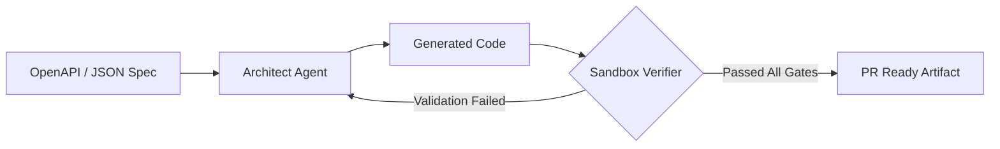

# Spec-Driven Development (SDD) Agent Starter

[](https://www.python.org/downloads/)
[](https://langchain-ai.github.io/langgraph/)

A deterministic **Spec-Driven Development (SDD)** agentic workflow built with **LangGraph**. Instead of relying on open-ended prompting, this blueprint enforces formal contracts (OpenAPI / JSON Schema) and automated static verification gates (`mypy`, `pytest`, schema validation) before any AI-generated code can reach a Pull Request.

## Architecture



## Key Features
* **Contract-First Generation:** Eliminates structural hallucinations by binding agent output to strict OpenAPI specifications.
* **Self-Healing Verification Loop:** Automatically feeds linter, type-check, and contract errors back into the agent state up to a bounded retry limit.
* **Provider Agnostic:** Pre-configured to route inference through LiteLLM or local vLLM endpoints.

## Quickstart

```bash
# 1. Install dependencies
pip install -e .

# 2. Run the SDD verification workflow
python -m src.graph
```

## Author
**Christian Axel Schmidt** — Principal AI & Systems Architect